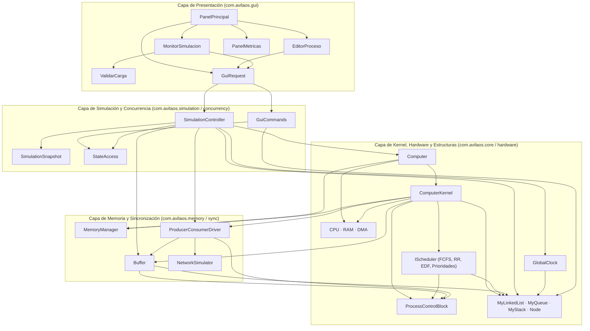
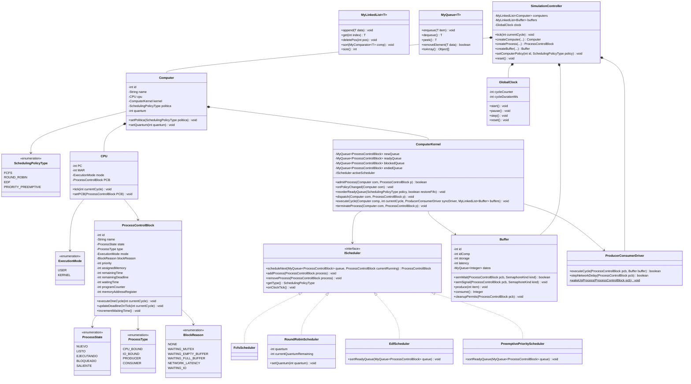
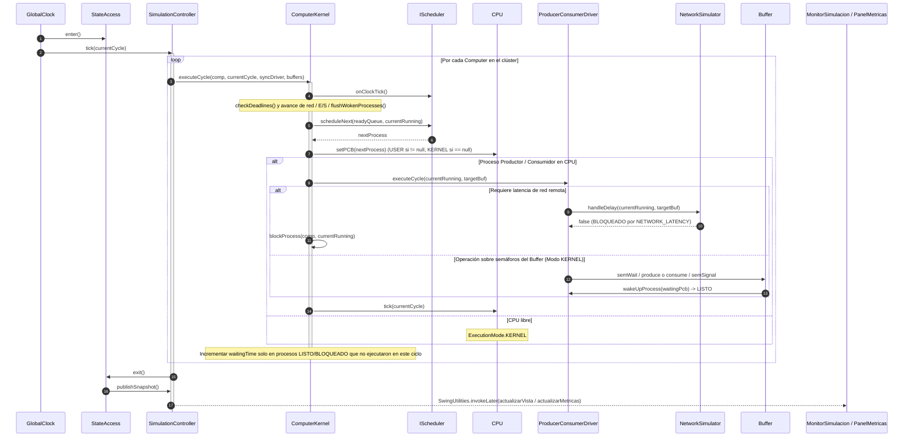

# ÁvilaOS — Simulador de Sistema Operativo Distribuido en Tiempo Real

Simulador académico de planificación de procesos de tiempo real, administración de memoria RAM y sincronización distribuida **Productor-Consumidor** mediante semáforos de Stallings y latencia de red, desarrollado en **Java** con interfaz gráfica en **Swing** y gráficas en tiempo real con **JFreeChart**.

📄 **[Ver Informe Técnico Completo (`docs/INFORME_TECNICO.md`)](docs/INFORME_TECNICO.md)**

---

## Características Principales

- **Estructuras de Datos 100% Propias (`com.avilaos.core.structures`):** Implementación desde cero de lista simplemente enlazada con ordenamiento in-situ (`MyLinkedList<T>`), cola FIFO (`MyQueue<T>`), pila LIFO (`MyStack<T>`) y nodo genérico (`Node<T>`), sin utilizar colecciones de `java.util`.
- **Modelo Monohilo 1:1 (`ProcessControlBlock`):** Cada proceso mantiene sus registros de hardware (`PC`, `MAR`), estado (`NUEVO`, `LISTO`, `EJECUTANDO`, `BLOQUEADO`, `SALIENTE`), modo de ejecución (`USER` / `KERNEL`), prioridad, *deadline*, tiempo de espera acumulado y titularidad de permisos semafóricos.
- **4 Políticas de Planificación Intercambiables en Caliente (`IScheduler`):**
  - **FCFS (`FcfsScheduler`):** *First-Come, First-Served* no apropiativo.
  - **Round Robin (`RoundRobinScheduler`):** Apropiativo por *quantum* configurable en tiempo real por computador.
  - **EDF (`EdfScheduler`):** *Earliest Deadline First* apropiativo por menor *deadline* restante.
  - **Prioridades Apropiativas (`PreemptivePriorityScheduler`):** Desalojo inmediato por mayor prioridad.
  - **Reordenamiento visual inmediato:** Al cambiar la política de cualquier computador desde la GUI, su cola de listos se reordena y actualiza al instante en pantalla.
- **Sincronización Distribuida Productor-Consumidor (`Buffer`, `ProducerConsumerDriver`, `NetworkSimulator`):**
  - Buffers acotados alojados en la RAM de un computador anfitrión con los 3 semáforos clásicos de Stallings (`mutex`, `llenos`, `vacios`).
  - Simulación de **latencia de red** configurable cuando un productor o consumidor opera sobre un buffer remoto.
- **Métricas en Tiempo Real con JFreeChart (`PanelMetricas`):**
  - Selector dinámico para graficar **Utilización de CPU (%)**, **Throughput (proc/ciclo)**, **Tasa de éxito de deadlines (%)** y **Tiempo promedio de espera (ticks)**.
- **Persistencia JSON Validada (`MonitorSimulacion`, `ValidarCarga`):**
  - Exportación e importación de escenarios completos en formato JSON y exportación de bitácoras `.log`.

---

## Requisitos y Ejecución

- **Java JDK:** 21 o superior (configurado para JDK 25 en `pom.xml`).
- **IDE recomendado:** Apache NetBeans 23+ o ejecución por línea de comandos con Maven.

### Compilar y ejecutar desde terminal
```powershell
mvn clean compile exec:java "-Dexec.mainClass=com.avilaos.Main"
```

---

## Diagrama de Arquitectura por Capas



---

## Diagrama UML de Clases



---

## Diagrama UML de Secuencia



---

## Estructura de Paquetes

```text
src/main/java/com/avilaos/
├── Main.java                        # Punto de entrada (inicia PanelPrincipal en el EDT)
├── concurrency/                     # StateAccess (exclusión mutua) y GuiCommands (hilo trabajador)
├── core/
│   ├── kernel/                      # ComputerKernel, GlobalClock e IClockTickable
│   ├── model/                       # ProcessControlBlock y los 5 Enums del dominio
│   ├── scheduler/                   # IScheduler, FcfsScheduler, RoundRobinScheduler, EdfScheduler, PreemptivePriorityScheduler
│   └── structures/                  # MyLinkedList, MyQueue, MyStack, Node y EstructuraVaciaException
├── gui/                             # PanelPrincipal, MonitorSimulacion, EditorProceso, PanelMetricas, ValidarCarga, GuiRequest
├── hardware/                        # Computer, CPU, RAM y DMA
├── memory/                          # MemoryManager (gestión contable de RAM)
├── simulation/                      # SimulationController y SimulationSnapshot
└── sync/                            # Buffer, ProducerConsumerDriver y NetworkSimulator
```
