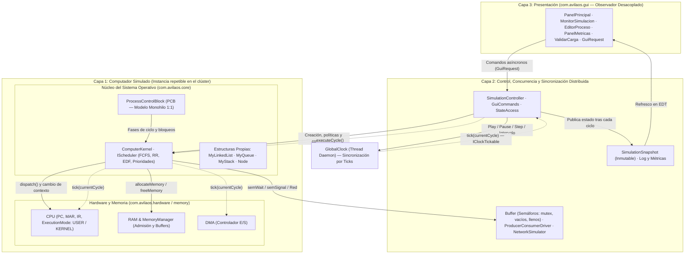
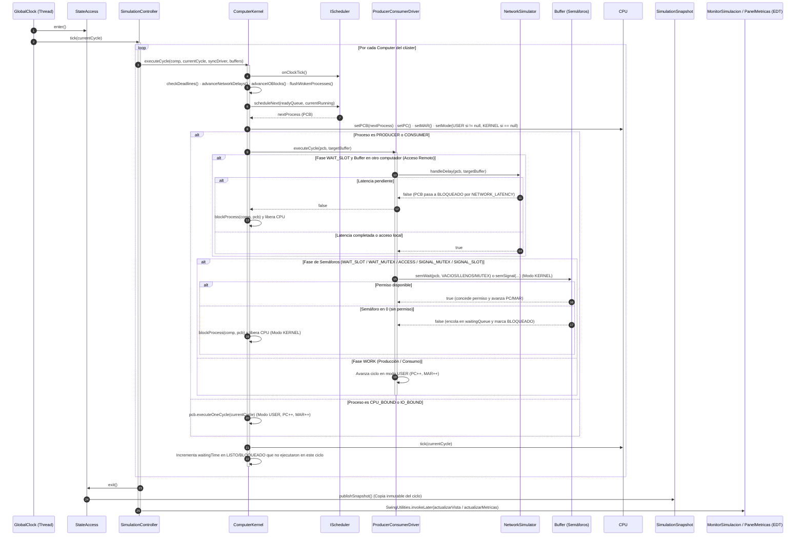

# 🏔️ ÁvilaOS — Simulador de Sistema Operativo Distribuido en Tiempo Real

> **Proyecto 1 — Sistemas Operativos**  
> Simulador en tiempo real de un sistema operativo distribuido monohilo sobre un clúster de computadores sincronizados por un reloj global, con estructuras de datos 100% propias, 4 políticas de planificación intercambiables en caliente y sincronización Productor-Consumidor (local y remota) mediante semáforos de Stallings y latencia de red.

📄 **[Ver Informe Técnico Completo (`docs/INFORME_TECNICO.md`)](docs/INFORME_TECNICO.md)**

---

## 📋 Tabla de Contenidos
1. [Características Principales](#-características-principales)
2. [Requisitos y Ejecución](#-requisitos-y-ejecución)
3. [Arquitectura por Capas](#-arquitectura-por-capas)
4. [Diagrama UML de Clases](#-diagrama-uml-de-clases)
5. [Diagrama UML de Secuencia](#-diagrama-uml-de-secuencia)
6. [Estructura de Paquetes](#-estructura-de-paquetes)
7. [Informe Técnico Completo](#-informe-técnico-completo)

---

## ✨ Características Principales

* **Clúster Distribuido Reutilizable:** Soporte para $N \ge 2$ computadores instanciados a partir de una única clase `Computer` y `ComputerKernel`, cada uno con su propia `CPU`, `RAM`, `DMA`, `MemoryManager` y colas independientes (`Nuevos`, `Listos`, `Bloqueados`, `Terminados`).
* **Estructuras de Datos 100% Propias (`com.avilaos.core.structures`):** Implementación desde cero de `Node<T>`, `MyLinkedList<T>` (con ordenamiento in-situ `sort`), `MyQueue<T>` y `MyStack<T>`, sin utilizar ninguna colección de `java.util.*`.
* **Modelo Monohilo 1:1 (`ProcessControlBlock`):** Cada proceso mantiene sus registros de hardware (`PC`, `MAR`), estado (`NUEVO`, `LISTO`, `EJECUTANDO`, `BLOQUEADO`, `SALIENTE`), modo de ejecución (`USER` / `KERNEL`), prioridad, *deadline*, tiempo de espera acumulado y titularidad de permisos semafóricos.
* **4 Políticas de Planificación en Caliente (`IScheduler`):**
  * **FCFS (`FcfsScheduler`):** *First-Come, First-Served* no apropiativo.
  * **Round Robin (`RoundRobinScheduler`):** Apropiativo con *quantum* configurable en tiempo real por computador.
  * **EDF (`EdfScheduler`):** *Earliest Deadline First* apropiativo por menor *deadline* restante.
  * **Prioridades Apropiativas (`PreemptivePriorityScheduler`):** Desalojo inmediato por mayor prioridad.
  * **Reordenamiento visual inmediato:** Al cambiar la política de cualquier computador desde la GUI, su cola de listos (`readyQueue`) se reordena y actualiza al instante en pantalla.
* **Sincronización Productor-Consumidor (Algoritmo de Stallings):** Buffers acotados alojados en la RAM de un computador anfitrión, protegidos con tres semáforos (`mutex`, `vacios`, `llenos`), soportando acceso **local** y **remoto** con **latencia de red** configurable en ciclos.
* **Concurrencia Real y Seguridad de Hilos:** Reloj global (`GlobalClock`) en hilo daemon independiente, cola de comandos (`GuiCommands`), exclusión mutua del modelo (`StateAccess`) y publicación de instantáneas inmutables (`SimulationSnapshot`) hacia la GUI Swing.
* **Métricas en Tiempo Real (`JFreeChart`) y Persistencia JSON (`Gson`):** Visualización por computador y global de **Utilización de CPU (%)**, **Throughput (proc/ciclo)**, **Tasa de éxito de Deadlines (%)** y **Tiempo promedio de espera (ticks)**, junto con exportación/importación validada de escenarios JSON (`ValidarCarga`) y exportación de bitácoras `.log`.

---

## 🚀 Requisitos y Ejecución

* **Java:** JDK 21 o superior (configurado para JDK 25 en `pom.xml`).
* **IDE recomendado:** Apache NetBeans 23+ (proyecto Maven nativo).
* **Librerías autorizadas (vía Maven):** `org.jfree:jfreechart:1.5.4` y `com.google.code.gson:gson:2.11.0`.

### Ejecución desde Apache NetBeans
1. Abrir el proyecto `Proyecto1.SistemasOperativos`.
2. Verificar en *Project Properties → Libraries* que `Java Platform` apunte a **JDK 25** (o ajustar `<maven.compiler.source>` / `<maven.compiler.target>` en `pom.xml` a tu versión de JDK 21+).
3. Ejecutar **Clean and Build** y luego **Run Project (F6)**.

### Ejecución desde Terminal (PowerShell)
```powershell
cd Proyecto1.SistemasOperativos
mvn clean compile exec:java "-Dexec.mainClass=com.avilaos.Main"
```

---

## 🏛️ Arquitectura por Capas



---

## 📐 Diagrama UML de Clases

```mermaid
classDiagram
    direction TB

    class IClockTickable {
        <<interface>>
        +tick(int currentCycle) void
    }

    class IScheduler {
        <<interface>>
        +scheduleNext(MyQueue~ProcessControlBlock~ queue, ProcessControlBlock currentRunning) ProcessControlBlock
        +addProcess(ProcessControlBlock process) void
        +removeProcess(ProcessControlBlock process) void
        +getReadyQueue() MyQueue~ProcessControlBlock~
        +getType() SchedulingPolicyType
        +onClockTick() void
    }

    class ProcessState {
        <<enumeration>>
        NUEVO
        LISTO
        EJECUTANDO
        BLOQUEADO
        SALIENTE
    }

    class ProcessType {
        <<enumeration>>
        CPU_BOUND
        IO_BOUND
        PRODUCER
        CONSUMER
    }

    class ExecutionMode {
        <<enumeration>>
        USER
        KERNEL
    }

    class SchedulingPolicyType {
        <<enumeration>>
        FCFS
        ROUND_ROBIN
        EDF
        PRIORITY_PREEMPTIVE
    }

    class BlockReason {
        <<enumeration>>
        NONE
        WAITING_MUTEX
        WAITING_EMPTY_BUFFER
        WAITING_FULL_BUFFER
        NETWORK_LATENCY
        WAITING_IO
    }

    class MyLinkedList~T~ {
        +append(T data) void
        +get(int index) T
        +deletePos(int pos) void
        +sort(MyComparator~T~ comp) void
        +size() int
    }

    class MyQueue~T~ {
        +enqueue(T item) void
        +dequeue() T
        +peek() T
        +removeElement(T data) boolean
        +toArray() Object[]
    }

    class GlobalClock {
        -GlobalClock INSTANCE$
        -MyLinkedList~IClockTickable~ subscribers
        -int cycleCounter
        -int cycleDurationMs
        -boolean running
        -boolean paused
        -Thread clockThread
        +getInstance()$ GlobalClock
        +start() void
        +pause() void
        +resume() void
        +step() void
        +reset() void
        +run() void
    }

    class SimulationController {
        -SimulationController instance$
        -MyLinkedList~Computer~ computers
        -MyLinkedList~Buffer~ buffers
        -GlobalClock clock
        -ProducerConsumerDriver syncDriver
        -SimulationSnapshot snapshot
        +getInstance()$ SimulationController
        +createComputer(String name, int ramSize, SchedulingPolicyType policy, int quantum) Computer
        +createProcess(...) ProcessControlBlock
        +createBuffer(int hostId, int storage, int memory) Buffer
        +setComputerPolicy(int id, SchedulingPolicyType policy) void
        +selectLeastLoadedComputer() Computer
        +tick(int currentCycle) void
        +reset() void
        +snapshot() SimulationSnapshot
    }

    class Computer {
        -int id
        -String name
        -CPU cpu
        -RAM ram
        -DMA dma
        -ComputerKernel kernel
        -MemoryManager memoryManager
        -SchedulingPolicyType politica
        -int quantum
        -int ciclosActivos
        -int ciclosObservados
        -int procesosCompletados
        -int procesosFinalizados
        -int deadlinesCumplidos
        -int totalTiempoRespuesta
        -int totalTiempoEspera
        +setPolitica(SchedulingPolicyType politica) void
        +setQuantum(int quantum) void
        +registrarCicloObservado() void
        +incrementarCicloActivo() void
        +registrarTerminacion(ProcessControlBlock pcb, int cicloActual) void
    }

    class ComputerKernel {
        -MyLinkedList~ProcessControlBlock~ processList
        -MyQueue~ProcessControlBlock~ newQueue
        -MyQueue~ProcessControlBlock~ readyQueue
        -MyQueue~ProcessControlBlock~ blockedQueue
        -MyQueue~ProcessControlBlock~ endedQueue
        -IScheduler activeScheduler
        +admitProcess(Computer com, ProcessControlBlock p) boolean
        +onPolicyChanged(Computer com) void
        +reorderReadyQueue(SchedulingPolicyType policy, boolean restoreFifo) void
        +dispatch(Computer com, ProcessControlBlock p) void
        +executeCycle(Computer comp, int currentCycle, ProducerConsumerDriver syncDriver, MyLinkedList~Buffer~ buffers) void
        +blockProcess(Computer com, ProcessControlBlock p) void
        +blockedToReady(ProcessControlBlock p) void
        +terminateProcess(Computer com, ProcessControlBlock p) void
        +placeBufferRAM(Buffer buffer, Computer com) boolean
    }

    class ProcessControlBlock {
        -int id
        -String name
        -int computerId
        -ProcessState state
        -ProcessType type
        -ExecutionMode mode
        -BlockReason blockReason
        -int priority
        -int assignedMemory
        -int totalInstructions
        -int remainingTime
        -int deadline
        -int remainingDeadline
        -int arrivalCycle
        -int startCycle
        -int completionCycle
        -int waitingTime
        -int programCounter
        -int memoryAddressRegister
        +executeOneCycle(int currentCycle) void
        +updateDeadlineOnTick(int currentCycle) void
        +incrementWaitingTime() void
        +resetIdGenerator(int initialValue)$ void
    }

    class CPU {
        -int PC
        -int MAR
        -int IR
        -ProcessControlBlock PCB
        -ExecutionMode mode
        +tick(int currentCycle) void
        +setPCB(ProcessControlBlock PCB) void
    }

    class MemoryManager {
        -RAM ram
        +hasAvailableMemory(int amount) boolean
        +allocateMemory(int amount) boolean
        +freeMemory(int amount) void
    }

    class Buffer {
        -int id
        -int idComp
        -int storage
        -int sizeInMemory
        -int latency
        -Semaphore mutex
        -Semaphore vacios
        -Semaphore llenos
        -MyQueue~Object~ datos
        -MyQueue~ProcessControlBlock~ waitingMutex
        -MyQueue~ProcessControlBlock~ waitingVacios
        -MyQueue~ProcessControlBlock~ waitingLlenos
        +semWait(ProcessControlBlock pcb, SemaphoreKind kind) boolean
        +semSignal(ProcessControlBlock emitter, SemaphoreKind kind) ProcessControlBlock
        +produce(Object item) void
        +consume() Object
        +cleanupPermits(ProcessControlBlock pcb) void
    }

    class ProducerConsumerDriver {
        -NetworkSimulator networkSimulator
        +executeCycle(ProcessControlBlock pcb, Buffer buffer) boolean
        +stepNetworkDelay(ProcessControlBlock pcb) boolean
        +wakeUpProcess(ProcessControlBlock pcb)$ void
    }

    class NetworkSimulator {
        -int latencyCycles
        +isRemoteAccess(ProcessControlBlock pcb, Buffer buffer) boolean
        +handleDelay(ProcessControlBlock pcb, Buffer buffer) boolean
        +stepDelay(ProcessControlBlock pcb) boolean
    }

    class FcfsScheduler
    class RoundRobinScheduler {
        -int quantum
        -int currentQuantumRemaining
        +setQuantum(int quantum) void
    }
    class EdfScheduler {
        +sortReadyQueue(MyQueue~ProcessControlBlock~ queue) void
    }
    class PreemptivePriorityScheduler {
        +sortReadyQueue(MyQueue~ProcessControlBlock~ queue) void
    }

    IClockTickable <|.. SimulationController
    IClockTickable <|.. CPU
    IScheduler <|.. FcfsScheduler
    IScheduler <|.. RoundRobinScheduler
    IScheduler <|.. EdfScheduler
    IScheduler <|.. PreemptivePriorityScheduler

    SimulationController --> GlobalClock : se suscribe
    SimulationController "1" *-- "0..*" Computer : gestiona
    SimulationController "1" *-- "0..*" Buffer : gestiona
    SimulationController --> ProducerConsumerDriver : coordina sync
    Computer "1" *-- "1" CPU
    Computer "1" *-- "1" MemoryManager
    Computer "1" *-- "1" ComputerKernel
    ComputerKernel --> IScheduler : delega selección
    ComputerKernel "1" *-- "0..*" ProcessControlBlock : administra colas
    ProducerConsumerDriver --> NetworkSimulator : aplica latencia
    ProducerConsumerDriver --> Buffer : ejecuta Stallings
    ProcessControlBlock --> ProcessState
    ProcessControlBlock --> ProcessType
    ProcessControlBlock --> ExecutionMode
    ProcessControlBlock --> BlockReason
    CPU --> ExecutionMode
    Computer --> SchedulingPolicyType
```



---

## 🔄 Diagrama UML de Secuencia

Interacción completa durante un ciclo del reloj global (`tick`), incluyendo exclusión mutua (`StateAccess`), planificación, acceso remoto de un proceso Productor/Consumidor con latencia de red, protocolo de semáforos de Stallings (`semWait` / `semSignal`) y publicación hacia la GUI:



---

## 📦 Estructura de Paquetes

```text
src/main/java/com/avilaos/
├── Main.java                              # Punto de entrada (lanza Swing en el EDT)
├── concurrency/
│   ├── GuiCommands.java                   # Hilo trabajador asíncrono para comandos de la GUI
│   └── StateAccess.java                   # Semáforo reentrante de exclusión mutua del modelo
├── core/
│   ├── kernel/
│   │   ├── ComputerKernel.java            # Núcleo del SO: admisión, colas, despacho y ciclo
│   │   ├── GlobalClock.java               # Reloj global Singleton multihilo
│   │   └── IClockTickable.java            # Interfaz para componentes sincronizados por reloj
│   ├── model/
│   │   ├── BlockReason.java               # Enum de motivos de bloqueo
│   │   ├── ExecutionMode.java             # Enum de modo de procesador (USER / KERNEL)
│   │   ├── ProcessControlBlock.java       # PCB: contexto, registros, tiempos y permisos
│   │   ├── ProcessState.java              # Enum de los 5 estados del proceso
│   │   ├── ProcessType.java               # Enum de tipos de proceso
│   │   └── SchedulingPolicyType.java      # Enum de las 4 políticas de planificación
│   ├── scheduler/
│   │   ├── IScheduler.java                # Interfaz común de planificación
│   │   ├── FcfsScheduler.java             # Política First-Come, First-Served
│   │   ├── RoundRobinScheduler.java       # Política Round Robin con quantum dinámico
│   │   ├── EdfScheduler.java              # Política Earliest Deadline First apropiativa
│   │   └── PreemptivePriorityScheduler.java # Política de Prioridades Apropiativas
│   └── structures/
│       ├── Node.java                      # Nodo genérico enlazado
│       ├── MyLinkedList.java              # Lista enlazada genérica propia con sort in-situ
│       ├── MyQueue.java                   # Cola FIFO genérica propia
│       ├── MyStack.java                   # Pila LIFO genérica propia
│       └── EstructuraVaciaException.java  # Excepción de acceso a estructura vacía
├── hardware/
│   ├── Computer.java                      # Unidad de computador reutilizable y métricas locales
│   ├── CPU.java                           # Procesador simulado (PC, MAR, IR, Mode)
│   ├── RAM.java                           # Memoria física simulada
│   └── DMA.java                           # Controlador de acceso directo a memoria / E/S
├── memory/
│   └── MemoryManager.java                 # Gestor contable de memoria usada y libre
├── sync/
│   ├── Buffer.java                        # Buffer acotado con 3 semáforos y colas de espera
│   ├── ProducerConsumerDriver.java        # Motor por fases del algoritmo de Stallings
│   └── NetworkSimulator.java              # Simulador de latencia de red entre nodos
├── simulation/
│   ├── SimulationController.java          # Orquestador del clúster y balanceador de carga
│   ├── SimulationSnapshot.java            # Foto inmutable de estado e historial para la GUI
│   └── ILogListener.java                  # Listener para eventos del log global
└── gui/
    ├── PanelPrincipal.java                # Ventana principal y navegación por módulos (01 a 06)
    ├── EditorProceso.java                 # Constructor interactivo de procesos con validación
    ├── MonitorSimulacion.java             # Monitor en tiempo real, colas, buffers y JSON
    ├── PanelMetricas.java                 # Gráfica JFreeChart multi-métrica y tablas de KPIs
    ├── ValidarCarga.java                  # Validador estricto de esquemas JSON y prevención de overflow
    ├── GuiRequest.java                    # Puente seguro de solicitudes EDT -> Modelo
    └── LogoAvila.java                     # Identidad gráfica vectorial
```

---

## 📄 Informe Técnico Completo

El documento detallado con la explicación exhaustiva de cada clase, método, enumeración, interfaz y análisis de políticas se encuentra en:  
👉 **[`docs/INFORME_TECNICO.md`](docs/INFORME_TECNICO.md)**
