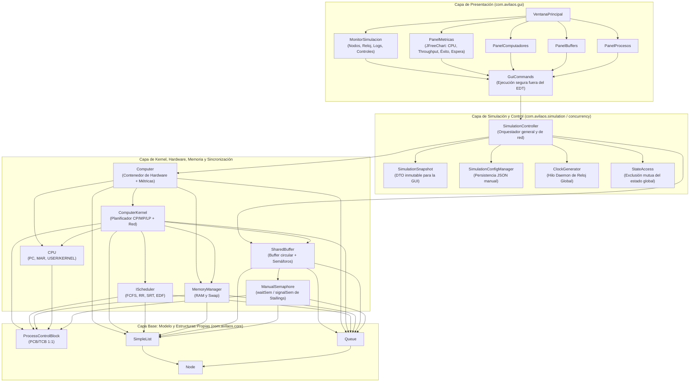
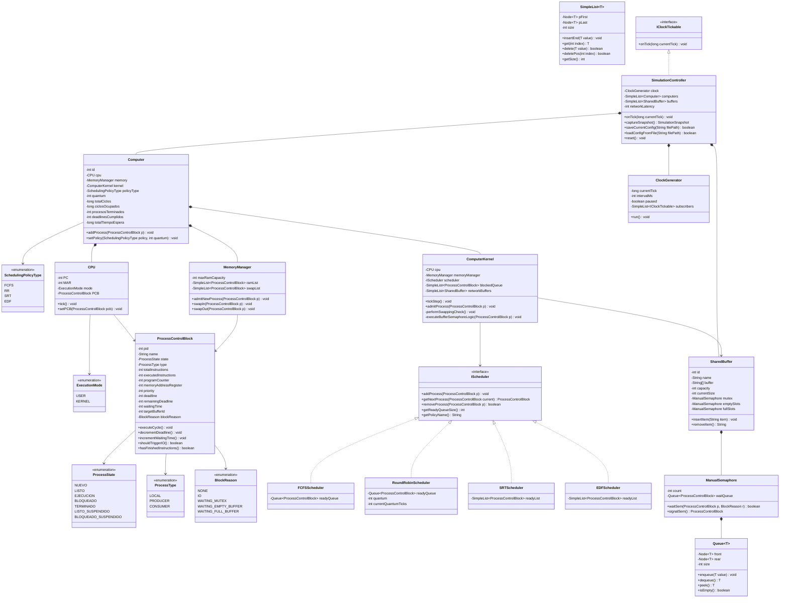
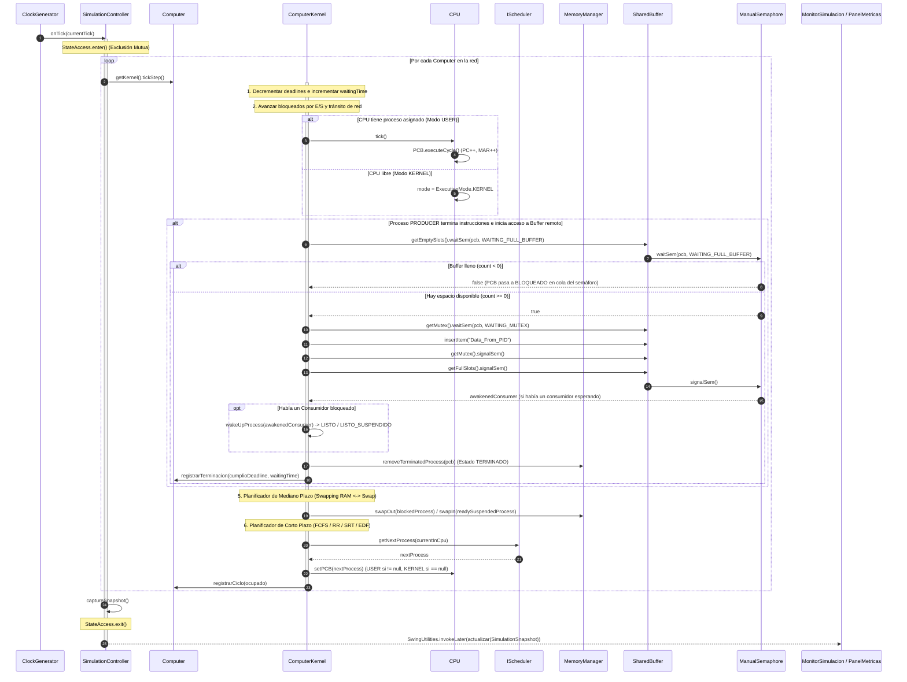

# Informe Técnico — Simulador de Sistemas Operativos (AvilaOS)

**Universidad Metropolitana (UNIMET)**  
**Asignatura:** Sistemas Operativos  
**Proyecto 1:** Simulador de Planificación de Procesos de Tiempo Real y Sincronización Distribuida Productor-Consumidor  

---

## Tabla de Contenidos

1. [Resumen Ejecutivo y Modelo de Procesos Monohilo](#1-resumen-ejecutivo-y-modelo-de-procesos-monohilo)
2. [Arquitectura por Capas](#2-arquitectura-por-capas)
3. [Enumerados (Enums) Utilizados](#3-enumerados-enums-utilizados)
4. [Interfaces Utilizadas](#4-interfaces-utilizadas)
5. [Funcionalidad de las Clases y Métodos Más Importantes](#5-funcionalidad-de-las-clases-y-métodos-más-importantes)
   - [5.1 Estructuras de Datos Propias (`com.avilaos.core.structures`)](#51-estructuras-de-datos-propias-comavilaoscorestructures)
   - [5.2 Modelo del Proceso (`com.avilaos.core.model`)](#52-modelo-del-proceso-comavilaoscoremodel)
   - [5.3 Algoritmos de Planificación (`com.avilaos.core.scheduler`)](#53-algoritmos-de-planificación-comavilaoscorescheduler)
   - [5.4 Sincronización y Buffers Compartidos (`com.avilaos.sync`)](#54-sincronización-y-buffers-compartidos-comavilaossync)
   - [5.5 Memoria Principal y Swapping (`com.avilaos.memory`)](#55-memoria-principal-y-swapping-comavilaosmemory)
   - [5.6 Hardware y Kernel del Nodo (`com.avilaos.hardware` y `com.avilaos.core.kernel`)](#56-hardware-y-kernel-del-nodo-comavilaoshardware-y-comavilaoscorekernel)
   - [5.7 Concurrencia, Reloj y Persistencia (`com.avilaos.concurrency` y `com.avilaos.simulation`)](#57-concurrencia-reloj-y-persistencia-comavilaosconcurrency-y-comavilaossimulation)
   - [5.8 Interfaz Gráfica y Gráficas de Rendimiento (`com.avilaos.gui`)](#58-interfaz-gráfica-y-gráficas-de-rendimiento-comavilaosgui)
6. [Diagramas UML ( compatibles con GitHub / Mermaid )](#6-diagramas-uml--compatibles-con-github--mermaid-)
   - [6.1 Diagrama UML de Clases](#61-diagrama-uml-de-clases)
   - [6.2 Diagrama UML de Secuencia](#62-diagrama-uml-de-secuencia)
7. [Métricas de Rendimiento y Análisis de Políticas de Planificación](#7-métricas-de-rendimiento-y-análisis-de-políticas-de-planificación)

---

## 1. Resumen Ejecutivo y Modelo de Procesos Monohilo

**AvilaOS** es un simulador en tiempo real desarrollado en Java 25 y Swing que modela una red de computadores interconectados mediante buffers acotados remotos. Cada computador opera de forma autónoma con su propio procesador (`CPU`), memoria principal (`RAM`) con paginación/partición fija y memoria secundaria (`Swap`), y su propio núcleo de sistema operativo (`ComputerKernel`) capaz de conmutar en caliente entre cuatro políticas de planificación: **FCFS**, **Round Robin (RR)**, **SRT (Shortest Remaining Time)** y **EDF (Earliest Deadline First)**.

### Modelo Monohilo (Relación 1:1 PCB ↔ TCB)
Siguiendo el diseño teórico de *William Stallings*, el simulador implementa un modelo de **procesos monohilo** donde existe una correspondencia **1 a 1** entre el **Bloque de Control de Proceso (`PCB`)** y el **Bloque de Control de Hilo (`TCB`)**:
- El `ProcessControlBlock` unifica tanto los atributos de propiedad de recursos (identificador `PID`, estado en memoria RAM/Swap, espacio de direcciones y tipo de proceso) como los atributos de ejecución y contexto de procesador (`PC` — *Program Counter*, `MAR` — *Memory Address Register*, estado de ejecución, prioridad, *deadline* y razón de bloqueo).
- Todas las estructuras de almacenamiento interno (listas enlazadas y colas FIFO) fueron construidas desde cero en el paquete `com.avilaos.core.structures` sin emplear ninguna colección de `java.util`.

---

## 2. Arquitectura por Capas

El sistema está diseñado bajo una arquitectura estricta de cuatro capas que desacopla la interfaz gráfica de usuario (`Swing`) del motor de simulación y de las estructuras del núcleo:

---

## 3. Enumerados (`Enums`) Utilizados

Todos los estados, modos de operación y políticas del sistema operativo están tipados mediante enumerados ubicados en el paquete `com.avilaos.core.enums`:

| Enum | Valores Definidos | Propósito y Uso en el Simulador |
| :--- | :--- | :--- |
| **`ProcessState`** | `NUEVO`, `LISTO`, `EJECUCION`, `BLOQUEADO`, `TERMINADO`, `LISTO_SUSPENDIDO`, `BLOQUEADO_SUSPENDIDO` | Modela el diagrama de **7 estados de Stallings**. Permite distinguir procesos residentes en memoria principal (`LISTO`, `BLOQUEADO`) de aquellos intercambiados a memoria secundaria Swap (`LISTO_SUSPENDIDO`, `BLOQUEADO_SUSPENDIDO`). |
| **`ProcessType`** | `LOCAL`, `PRODUCER`, `CONSUMER` | Clasifica el comportamiento del proceso: `LOCAL` ejecuta ráfagas de CPU/E/S internas; `PRODUCER` genera un ítem al finalizar su trabajo y lo deposita en un `SharedBuffer` remoto; `CONSUMER` extrae un ítem de un `SharedBuffer` remoto antes de procesarlo. |
| **`ExecutionMode`** | `USER`, `KERNEL` | Indica el nivel de privilegio actual de la `CPU`. Cuando la CPU ejecuta instrucciones de un proceso de usuario opera en `USER`; cuando la CPU está libre (ociosa), atiende una rutina del sistema o realiza un cambio de contexto, permanece en `KERNEL`. |
| **`SchedulingPolicyType`** | `FCFS`, `RR`, `SRT`, `EDF` | Identifica los 4 algoritmos de planificación soportados por cada computador. Se utiliza en `Computer.setPolicy(...)` y en la serialización JSON para cambiar el planificador en caliente. |
| **`BlockReason`** | `NONE`, `IO`, `WAITING_MUTEX`, `WAITING_EMPTY_BUFFER`, `WAITING_FULL_BUFFER` | Especifica la causa exacta por la que un proceso pasó al estado `BLOQUEADO` o `BLOQUEADO_SUSPENDIDO`: espera de entrada/salida (`IO`), exclusión mutua (`WAITING_MUTEX`), buffer lleno al intentar producir (`WAITING_FULL_BUFFER`) o buffer vacío al intentar consumir (`WAITING_EMPTY_BUFFER`). |

---

## 4. Interfaces Utilizadas

El proyecto emplea interfaces para aplicar polimorfismo, inversión de dependencias y desacoplamiento entre capas:

| Interfaz | Paquete | Métodos | Propósito y Clases que la Implementan |
| :--- | :--- | :--- | :--- |
| **`IScheduler`** | `com.avilaos.core.interfaces` | `addProcess(PCB)` `getNextProcess(PCB)` `removeProcess(PCB)` `isReadyQueueEmpty()` `getReadyQueueSize()` `getReadyProcessesSnapshot()` `getPolicyName()` | Define el contrato común para los algoritmos de planificación de corto plazo (Patrón *Strategy*). Implementada por `FCFSScheduler`, `RoundRobinScheduler`, `SRTScheduler` y `EDFScheduler`. Permite cambiar la política de cualquier computador en plena ejecución transfiriendo los procesos listos sin pérdida de estado. |
| **`IClockTickable`** | `com.avilaos.core.interfaces` | `onTick(long currentTick)` | Define el contrato de suscripción al reloj global del sistema (Patrón *Observer*). Implementada por `SimulationController`, que recibe cada pulso del `ClockGenerator` y coordina el avance síncrono de todos los computadores. |
| **`ILogListener`** | `com.avilaos.core.interfaces` | `onNewLog(String logEntry)` | Permite notificar en tiempo real a la interfaz gráfica cada vez que ocurre un evento del sistema operativo (cambios de contexto, bloqueos en semáforos, *swapping*, vencimiento de *deadlines*). |
| **`GuiCommands.Work<T>`** | `com.avilaos.gui` | `T run() throws Exception` | Interfaz funcional que encapsula una operación contra el `SimulationController` para ejecutarla en un hilo trabajador fuera del *Event Dispatch Thread* (EDT) de Swing. |
| **`GuiCommands.Result<T>`** | `com.avilaos.gui` | `void accept(T value)` | Interfaz funcional de *callback* que recibe en el hilo de eventos de Swing (EDT) el resultado devuelto por `GuiCommands.Work<T>`. |

---

## 5. Funcionalidad de las Clases y Métodos Más Importantes

### 5.1 Estructuras de Datos Propias (`com.avilaos.core.structures`)

Para cumplir con la restricción de diseño de no utilizar colecciones de `java.util`, todas las colas de planificación, tablas de memoria y listas de dispositivos se construyeron sobre las siguientes clases genéricas:

- **`Node<T>`**
  - Nodo básico de enlace simple con atributo `value` (`T`) y puntero `next` (`Node<T>`).
- **`SimpleList<T>`**
  - Lista simplemente enlazada genérica con punteros `pFirst`, `pLast` y contador `size`.
  - **Métodos clave:**
    - `insertEnd(T value)` / `insertBegin(T value)`: Inserción en $O(1)$ al final o al inicio de la lista.
    - `get(int index)`: Acceso posicional validado.
    - `delete(T value)` / `deletePos(int index)`: Eliminación por referencia (`equals`) o por índice, actualizando `pFirst` y `pLast`.
    - `contains(T value)`: Búsqueda lineal para verificar pertenencia.
- **`Queue<T>`**
  - Cola FIFO pura implementada con punteros `front` y `rear`.
  - **Métodos clave:**
    - `enqueue(T value)`: Encola un elemento al final (`rear`) en $O(1)$.
    - `dequeue()`: Desencola y retorna el elemento frontal (`front`) en $O(1)$.
    - `peek()`: Consulta el frente de la cola sin extraerlo.

---

### 5.2 Modelo del Proceso (`com.avilaos.core.model`)

- **`ProcessControlBlock`**
  - Representa la estructura unificada **PCB/TCB (1:1)** de cada proceso en el sistema.
  - **Atributos principales:** `pid`, `name`, `state` (`ProcessState`), `type` (`ProcessType`), `totalInstructions`, `executedInstructions`, `programCounter` (`PC`), `memoryAddressRegister` (`MAR`), `priority`, `deadline`, `remainingDeadline`, `ioExceptionCycle`, `ioDuration`, `currentIoWait`, `waitingTime`, `targetBufferId`, `blockReason`, `pendingItem`.
  - **Métodos más importantes:**
    - `executeCycle()`: Avanza la ejecución del proceso en 1 instrucción: incrementa `executedInstructions`, `programCounter` (`PC`) y `memoryAddressRegister` (`MAR`).
    - `decrementDeadline()`: Reduce en 1 ciclo el `remainingDeadline` si el proceso aún no ha terminado, permitiendo detectar incumplimientos de tiempo real.
    - `incrementWaitingTime()`: Incrementa el acumulador `waitingTime` en cada ciclo que el proceso permanece en espera (`LISTO` o `BLOQUEADO`).
    - `shouldTriggerIO()`: Verifica si el número de instrucciones ejecutadas alcanzó el ciclo configurado (`ioExceptionCycle`) para disparar una interrupción de E/S.
    - `advanceIoWait()` y `isIoCompleted()`: Controlan el temporizador de bloqueo por E/S hasta que el dispositivo completa la operación.
    - `hasFinishedInstructions()`: Determina si `executedInstructions >= totalInstructions`.
    - `resetIdGenerator(int nextValue)`: Reinicia la secuencia estática de `PID` al limpiar o cargar una nueva simulación.

---

### 5.3 Algoritmos de Planificación (`com.avilaos.core.scheduler`)

Todas las clases de este paquete implementan la interfaz `IScheduler`:

- **`FCFSScheduler` (*First-Come, First-Served*)**
  - Utiliza una `Queue<ProcessControlBlock>` estrictamente FIFO y no expropiativa.
  - `getNextProcess(currentProcess)`: Si hay un proceso en `EJECUCION`, lo mantiene en CPU hasta que termine o se bloquee; si la CPU está libre, desencola el primero de la cola de listos.
- **`RoundRobinScheduler` (*Round Robin con Quantum configurable*)**
  - Utiliza una `Queue<ProcessControlBlock>` circular y lleva el conteo de ticks consumidos en `currentQuantumTicks`.
  - `getNextProcess(currentProcess)`: Incrementa `currentQuantumTicks` en cada ciclo. Cuando `currentQuantumTicks >= quantum`, expropia al proceso actual, lo reencola al final de `readyQueue` en estado `LISTO`, reinicia el contador de quantum y despacha al siguiente proceso de la cola.
  - `setQuantum(int quantum)`: Permite ajustar dinámicamente el tamaño del quantum desde la interfaz gráfica.
- **`SRTScheduler` (*Shortest Remaining Time*)**
  - Política expropiativa basada en la ráfaga restante (`getRemainingInstructions()`).
  - `getNextProcess(currentProcess)`: Evalúa todos los procesos en `readyList` buscando el de menor número de instrucciones restantes (desempatando por prioridad y luego por `PID`). Si el mejor candidato tiene estrictamente menos instrucciones restantes que el proceso en CPU, realiza expropiación inmediata (*preemption*).
- **`EDFScheduler` (*Earliest Deadline First*)**
  - Política de tiempo real expropiativa orientada al cumplimiento de plazos (`remainingDeadline`).
  - `getNextProcess(currentProcess)`: Selecciona el proceso con menor `remainingDeadline` (mayor urgencia temporal). Si un proceso recién llegado a la cola de listos tiene un *deadline* más cercano que el proceso en ejecución, expropia la CPU inmediatamente para minimizar fallos de tiempo real.

---

### 5.4 Sincronización y Buffers Compartidos (`com.avilaos.sync`)

- **`ManualSemaphore`**
  - Implementa desde cero un **semáforo general y binario de Stallings** sin utilizar primitivas de bloqueo de Java para los procesos simulados. Posee un contador entero `count` y su propia cola FIFO de procesos bloqueados (`Queue<ProcessControlBlock> waitQueue`).
  - **Métodos más importantes:**
    - `waitSem(ProcessControlBlock process, BlockReason reason)`: Decrementa `count`. Si `count < 0`, cambia el estado del proceso a `BLOQUEADO`, registra el `BlockReason` correspondiente (`WAITING_MUTEX`, `WAITING_EMPTY_BUFFER` o `WAITING_FULL_BUFFER`), lo encola en `waitQueue` y retorna `false` para indicar al kernel que debe retirar el proceso de la CPU.
    - `signalSem()`: Incrementa `count`. Si `count <= 0`, desencola el primer proceso esperando en `waitQueue`, limpia su `BlockReason` a `NONE` y lo retorna al kernel para que sea reactivado (`LISTO` o `LISTO_SUSPENDIDO`).
- **`SharedBuffer`**
  - Modela un canal o buffer circular acotado compartido en la red entre múltiples computadores productores y consumidores.
  - Contiene un arreglo circular `String[] buffer` de capacidad fija (`capacity`) y **tres instancias de `ManualSemaphore`**:
    1. `mutex` (inicializado en `1`): Garantiza exclusión mutua al manipular los punteros `in`, `out` y `currentSize`.
    2. `emptySlots` (inicializado en `capacity`): Cuenta los espacios libres disponibles para productores.
    3. `fullSlots` (inicializado en `0`): Cuenta los ítems disponibles para consumidores.
  - **Métodos más importantes:**
    - `insertItem(String item)`: Inserta un dato en la posición `in`, avanza circularmente `(in + 1) % capacity` e incrementa el contador histórico `producedTotal`.
    - `removeItem()`: Extrae el dato en la posición `out`, avanza circularmente `(out + 1) % capacity` e incrementa `consumedTotal`.
    - `getBufferContentSnapshot()`: Devuelve una copia segura del estado actual de cada celda del buffer para su visualización en tiempo real en la GUI.

---

### 5.5 Memoria Principal y Swapping (`com.avilaos.memory`)

- **`MemoryManager`**
  - Gestiona la memoria principal (`ramList`) de tamaño máximo `maxRamCapacity` (medida en cantidad de PCBs residentes) y la memoria secundaria de intercambio (`swapList`).
  - **Métodos más importantes:**
    - `admitNewProcess(ProcessControlBlock process)`: Planificador de Largo Plazo. Si `hasSpaceInRam()` es verdadero, carga el proceso en `ramList` y lo pasa a `LISTO`; si la RAM está llena, lo envía a `swapList` en estado `LISTO_SUSPENDIDO`.
    - `swapOut(ProcessControlBlock process)`: Planificador de Mediano Plazo. Retira un proceso de `ramList`, lo traslada a `swapList` y actualiza su estado de `BLOQUEADO` a `BLOQUEADO_SUSPENDIDO` (o de `LISTO` a `LISTO_SUSPENDIDO`), liberando un marco de RAM.
    - `swapIn(ProcessControlBlock process)`: Trae un proceso desde `swapList` hacia `ramList` cuando se libera espacio en RAM, cambiando su estado de `LISTO_SUSPENDIDO` a `LISTO` (o de `BLOQUEADO_SUSPENDIDO` a `BLOQUEADO`).

---

### 5.6 Hardware y Kernel del Nodo (`com.avilaos.hardware` y `com.avilaos.core.kernel`)

- **`CPU`**
  - Simula el procesador físico de un computador, manteniendo los registros internos `PC`, `MAR`, el modo de ejecución (`ExecutionMode.USER` o `ExecutionMode.KERNEL`) y la referencia al `PCB` en ejecución.
  - **Métodos más importantes:**
    - `tick()`: Si hay un proceso asignado, conmuta a `ExecutionMode.USER`, invoca `PCB.executeCycle()` y sincroniza los registros `PC` y `MAR` del procesador con los del proceso. Si no hay proceso asignado (`PCB == null`), mantiene la CPU en `ExecutionMode.KERNEL`.
    - `setPCB(ProcessControlBlock pcb)`: Realiza el cambio de contexto en los registros del hardware; cuando recibe `null`, restablece el modo a `ExecutionMode.KERNEL`.
- **`Computer`**
  - Ensambla los componentes de un nodo de la red (`CPU`, `MemoryManager`, `ComputerKernel`) y lleva las estadísticas acumuladas de rendimiento del nodo (`totalCiclos`, `ciclosOcupados`, `procesosTerminados`, `deadlinesCumplidos`, `deadlinesFallidos`, `totalTiempoEspera`).
  - **Métodos más importantes:**
    - `addProcess(ProcessControlBlock p)`: Registra el proceso en la tabla maestra del nodo (`allProcesses`) y delega su admisión al `ComputerKernel`.
    - `setPolicy(SchedulingPolicyType policyType, int quantum)`: Instancia el nuevo `IScheduler` seleccionado y transfiere en caliente todos los procesos de la cola de listos anterior al nuevo planificador.
    - `registrarCiclo(boolean ocupado)` y `registrarTerminacion(boolean cumplioDeadline, int waitingTime)`: Actualizan los contadores estadísticos para el cálculo de métricas.
- **`ComputerKernel`**
  - Es el corazón operativo de cada computador. Coordina la planificación de corto, mediano y largo plazo, la atención de interrupciones de E/S y el protocolo de sincronización distribuida Productor-Consumidor con latencia de red.
  - **Métodos más importantes:**
    - `tickStep()`: Ejecuta un ciclo completo del sistema operativo en 6 fases ordenadas:
      1. Decrementa los *deadlines* de todos los procesos activos e incrementa el `waitingTime` de los procesos en `LISTO` o `BLOQUEADO`.
      2. Avanza los temporizadores de procesos bloqueados por E/S (`handleBlockedQueue`) y de mensajes en tránsito por la red (`handleNetworkTransit`).
      3. Ejecuta el ciclo de instrucción en la `CPU` si hay un proceso activo.
      4. Verifica si el proceso en `CPU` disparó una interrupción de E/S (`shouldTriggerIO`) o si completó sus instrucciones (`hasFinishedInstructions`), iniciando las operaciones de red/semáforos si es `PRODUCER` o `CONSUMER`.
      5. Ejecuta el Planificador de Mediano Plazo (`performSwappingCheck`): si hay procesos en `LISTO_SUSPENDIDO` y la RAM está llena pero existen procesos bloqueados en RAM, aplica `swapOut` al proceso bloqueado para hacer `swapIn` del proceso listo.
      6. Invoca al Planificador de Corto Plazo (`scheduler.getNextProcess(...)`) para despachar o expropiar el proceso en la `CPU`.
    - `initiateNetworkOperation(PCB)` y `executeBufferSemaphoreLogic(PCB)`: Simulan la latencia de red (`networkLatency`) antes de acceder a un `SharedBuffer` remoto y ejecutan la secuencia clásica de semáforos de Stallings:
      - **Productor:** `emptySlots.waitSem()` $\rightarrow$ `mutex.waitSem()` $\rightarrow$ `insertItem()` $\rightarrow$ `mutex.signalSem()` $\rightarrow$ `fullSlots.signalSem()`.
      - **Consumidor:** `fullSlots.waitSem()` $\rightarrow$ `mutex.waitSem()` $\rightarrow$ `removeItem()` $\rightarrow$ `mutex.signalSem()` $\rightarrow$ `emptySlots.signalSem()`.
    - `wakeUpProcess(ProcessControlBlock awakened)`: Cuando un `signalSem()` despierta a un proceso (incluso si pertenece a otro computador de la red), este método localiza el nodo dueño del proceso y lo transiciona a `LISTO` (encolándolo en su `IScheduler`) o a `LISTO_SUSPENDIDO` si había sido enviado a Swap.

---

### 5.7 Concurrencia, Reloj y Persistencia (`com.avilaos.concurrency` y `com.avilaos.simulation`)

- **`ClockGenerator`**
  - Hilo demonio (`Thread` con `setDaemon(true)`) que genera los pulsos de reloj (`ticks`) de la simulación.
  - Utiliza un `java.util.concurrent.Semaphore(1)` para proteger la lectura/escritura de su estado (`paused`, `intervalMs`, `currentTick`) y notifica en cada ciclo a todos los suscriptores `IClockTickable`.
- **`StateAccess`**
  - Monitor global basado en un `Semaphore(1, true)` justo (*fair*) con soporte de reentrancia por hilo (`owner` y `depth`). Garantiza exclusión mutua estricta entre el hilo del reloj (`ClockGenerator`) y los hilos trabajadores de la interfaz gráfica (`GuiCommands`) al leer o modificar el estado de la simulación.
- **`SimulationController`**
  - Controlador central que administra la lista de computadores (`SimpleList<Computer>`), la lista de buffers compartidos (`SimpleList<SharedBuffer>`), el `ClockGenerator` y la bitácora de eventos (`eventLogs`).
  - **Métodos más importantes:**
    - `onTick(long currentTick)`: Recibe el pulso del reloj bajo protección de `StateAccess`, invoca `tickStep()` en cada `Computer`, registra alertas de inanición/*deadlines* y dispara la actualización de la GUI.
    - `captureSnapshot()`: Construye y retorna un objeto `SimulationSnapshot` inmutable con toda la telemetría del ciclo actual para que Swing repinte sin riesgo de condiciones de carrera.
    - `loadDefaultSimulation()`, `saveCurrentConfig(String)` y `loadConfigFromFile(String)`: Gestionan la carga del escenario inicial y la persistencia en archivos JSON.
    - `reset()`: Detiene y reinicia el reloj a 0, vacía computadores y buffers, y restablece el generador de `PID` a 1.
- **`SimulationConfigManager`**
  - Parser y serializador JSON recursivo escrito a mano (sin librerías externas ni `java.util`), capaz de exportar e importar la topología completa de computadores, políticas, quantums, latencia de red, buffers y procesos con sus atributos.

---

### 5.8 Interfaz Gráfica y Gráficas de Rendimiento (`com.avilaos.gui`)

- **`VentanaPrincipal`**: Ventana principal con navegación por pestañas (`Simulación`, `Métricas`, `Computadores`, `Buffers`, `Procesos`) y barra de estado inferior sincronizada con el reloj y el estado de ejecución.
- **`MonitorSimulacion`**: Panel maestro de monitoreo en tiempo real. Muestra las tarjetas de cada computador (`VistaComputador` con estado de `CPU`, modo `USER`/`KERNEL`, registros `PC` y `MAR`, ocupación de `RAM`/`Swap`, colas de `Listos`, `Bloqueados`, `Swap Listo` y `Swap Bloqueado`), el estado casilla por casilla de cada `SharedBuffer`, el control de velocidad del reloj (`ms/ciclo`) y la bitácora de eventos del sistema operativo.
- **`PanelMetricas`**: Panel de análisis cuantitativo con **JFreeChart**. Incorpora un selector interactivo (`JComboBox`) que permite graficar en tiempo real las **4 métricas exigidas** por computador y a nivel global:
  1. **Utilización de CPU (%)**
  2. **Throughput (procesos/ciclo)**
  3. **Tasa de éxito de misión / Deadlines (%)**
  4. **Tiempo promedio de espera (ticks)**
- **`PanelComputadores`, `PanelBuffers` y `PanelProcesos`**: Formularios CRUD interactivos para agregar/eliminar computadores, cambiar políticas de planificación y quantum en caliente, crear buffers compartidos y generar procesos individuales o ráfagas de 20 procesos aleatorios.
- **`GuiCommands`**: Despachador asíncrono que ejecuta todas las mutaciones solicitadas por el usuario en hilos trabajadores en segundo plano, evitando congelar el hilo de eventos de Swing (EDT).

---

## 6. Diagramas UML (compatibles con GitHub / Mermaid)

### 6.1 Diagrama UML de Clases

---

### 6.2 Diagrama UML de Secuencia

El siguiente diagrama de secuencia modela un pulso del reloj (`onTick`), la ejecución de instrucciones en `CPU`, la sincronización de un proceso **Productor** sobre un `SharedBuffer` remoto mediante semáforos (`emptySlots`, `mutex`, `fullSlots`), el despertar de un proceso **Consumidor** bloqueado en otro nodo y la actualización asíncrona de la interfaz gráfica mediante `SimulationSnapshot`:

---

## 7. Métricas de Rendimiento y Análisis de Políticas de Planificación

En el panel **`02. Métricas`** (`PanelMetricas`), el simulador calcula y grafica en tiempo real cuatro indicadores clave de desempeño tanto por computador individual como para toda la red:

1. **Utilización de CPU (%):**
   $$\text{Utilización de CPU} = \left( \frac{\text{Ciclos Ocupados}}{\text{Ciclos Totales}} \right) \times 100$$
2. **Throughput (procesos/ciclo):**
   $$\text{Throughput} = \frac{\text{Procesos Terminados}}{\text{Ciclos Totales}}$$
3. **Tasa de Éxito de Misión / Cumplimiento de Deadlines (%):**
   $$\text{Tasa de Éxito} = \left( \frac{\text{Deadlines Cumplidos}}{\text{Deadlines Cumplidos} + \text{Deadlines Fallidos}} \right) \times 100$$
4. **Tiempo Promedio de Espera (ticks):**
   $$\text{Espera Promedio} = \frac{\sum \text{Ticks en estado LISTO o BLOQUEADO}}{\text{Procesos Terminados}}$$

### Comportamiento Comparativo de los Algoritmos

| Política | Tipo | Ventaja Principal en la Simulación | Escenario de Degradación |
| :--- | :--- | :--- | :--- |
| **FCFS** | No expropiativa | Cero sobrecarga de expropiación; orden predecible de llegada. | Sufre el **efecto convoy**: un proceso largo en CPU retrasa procesos cortos o con *deadlines* urgentes, elevando el tiempo de espera y los fallos de *deadline*. |
| **Round Robin (RR)** | Expropiativa por tiempo (`Quantum`) | Reparte equitativamente el procesador y mejora el tiempo de respuesta interactivo. | Si el *quantum* es demasiado grande degenera en FCFS; no distingue urgencia de *deadlines*. |
| **SRT** | Expropiativa por ráfaga restante | Minimiza el **tiempo promedio de espera** y maximiza el **Throughput** al despachar primero los trabajos más cortos. | Puede provocar **inanición (*starvation*)** de procesos largos si ingresan continuamente procesos cortos. |
| **EDF** | Expropiativa por *deadline* | Maximiza la **Tasa de Éxito de Misión (%)** en cargas de tiempo real al priorizar siempre el proceso cuyo plazo vence más pronto. | Bajo sobrecarga extrema (cuando la demanda supera el 100% de capacidad de CPU), varios procesos cercanos a vencer pueden fallar en cascada (*efecto dominó*). |

