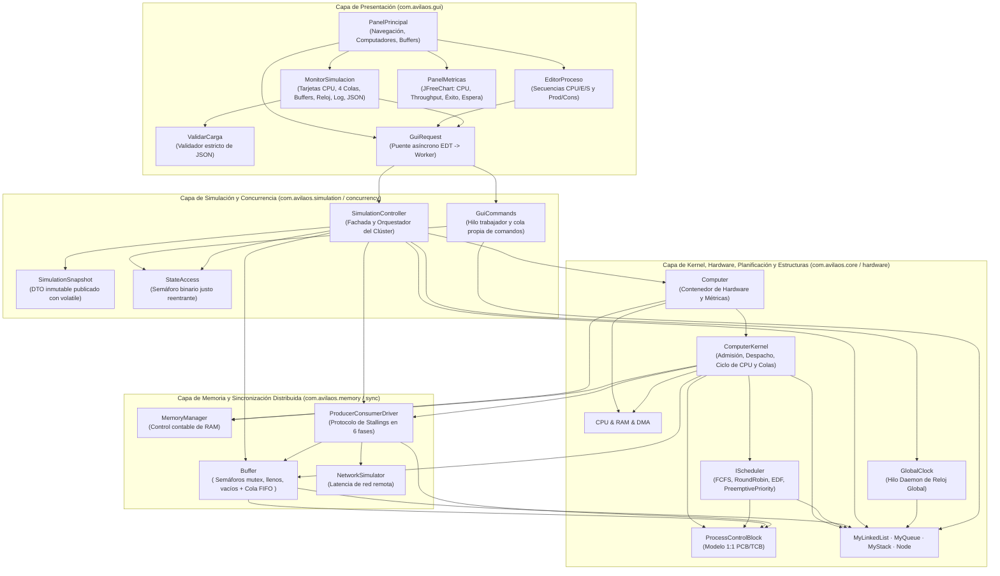
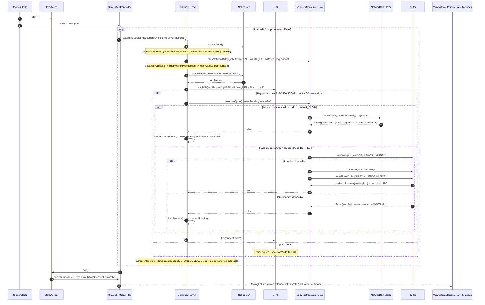

# Informe Técnico — Simulador de Sistemas Operativos (ÁvilaOS)

**Universidad Metropolitana (UNIMET)**  
**Asignatura:** Sistemas Operativos  
**Proyecto 1:** Simulador de Planificación de Procesos de Tiempo Real y Sincronización Distribuida Productor-Consumidor  

---

## Tabla de Contenidos

1. [Resumen Ejecutivo y Modelo de Procesos Monohilo](#1-resumen-ejecutivo-y-modelo-de-procesos-monohilo)
2. [Arquitectura por Capas](#2-arquitectura-por-capas)
3. [Enumerados (Enums) Utilizados](#3-enumerados-enums-utilizados)
4. [Interfaces Utilizadas](#4-interfaces-utilizadas)
5. [Funcionalidad de las Clases y Métodos Más Importantes](#5-funcionalidad-de-las-clases-y-métodos-más-importantes)
   - [5.1 Estructuras de Datos Propias (`com.avilaos.core.structures`)](#51-estructuras-de-datos-propias-comavilaoscorestructures)
   - [5.2 Modelo del Proceso (`com.avilaos.core.model`)](#52-modelo-del-proceso-comavilaoscoremodel)
   - [5.3 Algoritmos de Planificación (`com.avilaos.core.scheduler`)](#53-algoritmos-de-planificación-comavilaoscorescheduler)
   - [5.4 Sincronización, Red y Buffers Compartidos (`com.avilaos.sync`)](#54-sincronización-red-y-buffers-compartidos-comavilaossync)
   - [5.5 Memoria Principal RAM (`com.avilaos.memory` y `com.avilaos.hardware`)](#55-memoria-principal-ram-comavilaosmemory-y-comavilaoshardware)
   - [5.6 Hardware, Reloj Global y Kernel del Nodo (`com.avilaos.hardware` y `com.avilaos.core.kernel`)](#56-hardware-reloj-global-y-kernel-del-nodo-comavilaoshardware-y-comavilaoscorekernel)
   - [5.7 Concurrencia, Controlador y Snapshots (`com.avilaos.concurrency` y `com.avilaos.simulation`)](#57-concurrencia-controlador-y-snapshots-comavilaosconcurrency-y-comavilaossimulation)
   - [5.8 Interfaz Gráfica, Persistencia JSON y Métricas (`com.avilaos.gui`)](#58-interfaz-gráfica-persistencia-json-y-métricas-comavilaosgui)
   - [5.9 Manejo de Hilos de Java y Sincronización](#59-manejo-de-hilos-de-java-y-sincronización)
6. [Diagramas UML (compatibles con GitHub / Mermaid)](#6-diagramas-uml-compatibles-con-github--mermaid)
   - [6.1 Diagrama UML de Clases](#61-diagrama-uml-de-clases)
   - [6.2 Diagrama UML de Secuencia](#62-diagrama-uml-de-secuencia)
7. [Métricas de Rendimiento y Análisis de Políticas de Planificación](#7-métricas-de-rendimiento-y-análisis-de-políticas-de-planificación)

---

## 1. Resumen Ejecutivo y Modelo de Procesos Monohilo

**ÁvilaOS** es un simulador de sistema operativo distribuido en tiempo real desarrollado en Java y Swing que modela un clúster de computadores interconectados mediante buffers acotados locales y remotos. Cada computador opera como una instancia reutilizable con su propio procesador (`CPU`), memoria principal (`RAM`), administrador de memoria (`MemoryManager`) y núcleo de sistema operativo (`ComputerKernel`), capaz de alternar en caliente entre cuatro políticas de planificación: **FCFS (`FcfsScheduler`)**, **Round Robin (`RoundRobinScheduler`)**, **EDF (`EdfScheduler`)** y **Prioridades Apropiativas (`PreemptivePriorityScheduler`)**.

### Modelo Monohilo (Relación 1:1 PCB ↔ TCB)
Siguiendo el diseño teórico de *William Stallings*, el simulador implementa un modelo de **procesos monohilo** donde existe una correspondencia **1 a 1** entre el **Bloque de Control de Proceso (`PCB`)** y el flujo de ejecución:
- La clase `ProcessControlBlock` unifica tanto los atributos de propiedad de recursos (identificador único `id`, `computerId`, memoria requerida/asignada `assignedMemory`, tipo de proceso y titularidad de permisos de buffer) como los atributos de contexto de ejecución en procesador (`programCounter` — `PC`, `memoryAddressRegister` — `MAR`, `state`, `mode`, `priority`, `deadline`, `remainingDeadline`, `waitingTime` y `blockReason`).
- Todas las estructuras de almacenamiento interno (`MyLinkedList<T>`, `MyQueue<T>`, `MyStack<T>` y `Node<T>`) fueron construidas desde cero en el paquete `com.avilaos.core.structures` sin utilizar ninguna colección de `java.util`.

---

## 2. Arquitectura por Capas

El sistema está diseñado bajo una arquitectura desacoplada por capas que separa la interfaz gráfica (`Swing`) del controlador de simulación, de los módulos de memoria/sincronización y del núcleo del sistema operativo:

---

## 3. Enumerados (`Enums`) Utilizados

Todos los estados, modos de operación y políticas del sistema operativo están definidos mediante enumerados en `com.avilaos.core.model`:

| Enum | Valores Definidos | Propósito y Uso en el Simulador |
| :--- | :--- | :--- |
| **`ProcessState`** | `NUEVO`, `LISTO`, `EJECUTANDO`, `BLOQUEADO`, `SALIENTE` | Representa los 5 estados del ciclo de vida del proceso: espera de admisión por RAM (`NUEVO`), en cola de listos (`LISTO`), ejecutando en procesador (`EJECUTANDO`), esperando E/S, red o semáforo (`BLOQUEADO`) y finalizado (`SALIENTE`). |
| **`ProcessType`** | `CPU_BOUND`, `IO_BOUND`, `PRODUCER`, `CONSUMER` | Clasifica la naturaleza del proceso: cálculo intensivo (`CPU_BOUND`), ráfagas periódicas de entrada/salida (`IO_BOUND`), productor de elementos hacia un buffer (`PRODUCER`) o consumidor de elementos (`CONSUMER`). |
| **`ExecutionMode`** | `USER`, `KERNEL` | Indica el nivel de privilegio actual de la `CPU` y del proceso. Cuando la CPU está libre (`CPU libre · KERNEL`) o ejecuta primitivas de sincronización (`semWait`, `semSignal`, acceso a buffer) opera en modo `KERNEL`; durante instrucciones normales de programa opera en modo `USER`. |
| **`SchedulingPolicyType`** | `FCFS`, `ROUND_ROBIN`, `EDF`, `PRIORITY_PREEMPTIVE` | Identifica los 4 algoritmos de planificación soportados por cada computador, permitiendo su selección inicial y cambio en caliente durante la simulación. |
| **`BlockReason`** | `NONE`, `WAITING_MUTEX`, `WAITING_EMPTY_BUFFER`, `WAITING_FULL_BUFFER`, `NETWORK_LATENCY`, `WAITING_IO` | Especifica la causa exacta por la que un proceso permanece en la cola de `BLOQUEADO`: esperando exclusión mutua (`WAITING_MUTEX`), buffer vacío al consumir (`WAITING_EMPTY_BUFFER`), buffer lleno al producir (`WAITING_FULL_BUFFER`), retardo de red remota (`NETWORK_LATENCY`) o ráfaga de E/S (`WAITING_IO`). |
| **`ProcessControlBlock.SyncPhase`** | `WAIT_SLOT`, `WAIT_MUTEX`, `ACCESS`, `SIGNAL_MUTEX`, `SIGNAL_SLOT`, `WORK` | Modela las 6 etapas atómicas (1 instrucción por ciclo) del protocolo Productor-Consumidor de Stallings dentro del PCB. |
| **`ProcessControlBlock.BufferPermit`** | `MUTEX`, `VACIOS`, `LLENOS` | Registra los permisos semafóricos adquiridos por un PCB para garantizar su devolución exacta (`cleanupPermits`) incluso si el proceso aborta por vencimiento de *deadline*. |

---

## 4. Interfaces Utilizadas

El proyecto utiliza interfaces para aplicar polimorfismo (*Strategy* en planificadores y *Observer* en reloj, bitácora y sincronización con la GUI):

| Interfaz | Ubicación | Métodos | Propósito y Clases que la Implementan |
| :--- | :--- | :--- | :--- |
| **`IScheduler`** | `com.avilaos.core.scheduler` | `scheduleNext(MyQueue<PCB>, PCB)` `addProcess(PCB)` `removeProcess(PCB)` `getReadyQueue()` `getType()` `onClockTick()` | Contrato común para las políticas de planificación de corto plazo. Implementada por `FcfsScheduler`, `RoundRobinScheduler`, `EdfScheduler` y `PreemptivePriorityScheduler`. |
| **`IClockTickable`** | `com.avilaos.core.kernel` | `tick(int currentCycle)` | Contrato para todos los componentes reactivos al pulso del reloj global (`SimulationController`, `CPU` y `DMA`). |
| **`SimulationController.ILogListener`** | `com.avilaos.simulation` | `onLogAdded(String message)` | Observador propio para notificar en lotes seguros al panel de bitácora de `MonitorSimulacion` cada evento del sistema operativo. |
| **`ComputerKernel.IEventListener`** **`ProducerConsumerDriver.IEventListener`** | `com.avilaos.core.kernel` `com.avilaos.sync` | `accept(String message)` | Interfaces funcionales propias (sin depender de `java.util.function`) para emitir eventos desde el kernel y el driver de sincronización hacia el controlador. |
| **`GuiCommands.Work<T>`** **`GuiCommands.Result<T>`** | `com.avilaos.concurrency` | `T run() throws Exception` `void accept(T value)` | Interfaces funcionales para encolar tareas del modelo en el hilo trabajador `AvilaOS-Commands` y entregar el resultado en el *Event Dispatch Thread* (EDT) de Swing. |

---

## 5. Funcionalidad de las Clases y Métodos Más Importantes

### 5.1 Estructuras de Datos Propias (`com.avilaos.core.structures`)

Construidas desde cero mediante nodos enlazados simples sin emplear ninguna clase de `java.util`:

- **`Node<T>`**: Nodo genérico autorreferenciado con atributo `data` (`T`) y enlace `pNext` (`Node<T>`).
- **`MyLinkedList<T>`**: Lista simplemente enlazada genérica con punteros `pFirst`, `pLast` y tamaño `size`.
  - **Clases internas propias:** `MyComparator<E>` (clase abstracta comparadora) y `MyLinkedListIterator` (iterador propio).
  - **Métodos clave:** `append(T)`, `insertFirst(T)`, `insertPos(int, T)`, `deleteFirst()`, `deleteLast()`, `deletePos(int)`, `remove(T)`, `get(int)`, `contains(T)` y `sort(MyComparator<T>)` (ordenamiento por inserción in-situ sobre nodos enlazados).
- **`MyQueue<T>`**: Cola genérica FIFO con punteros `pFirst` y `pLast`.
  - **Métodos clave:** `enqueue(T)` / `queue(T)`, `dequeue()`, `peek()`, `removeElement(T)` y `toArray()`.
- **`MyStack<T>`**: Pila genérica LIFO con puntero `pTop`.
  - **Métodos clave:** `push(T)`, `pop()` y `peek()`.

---

### 5.2 Modelo del Proceso (`com.avilaos.core.model`)

- **`ProcessControlBlock`**
  - Representa la estructura unificada **PCB/TCB** de cada proceso en el clúster.
  - **Métodos más importantes:**
    - `allocateId()` y `resetIdGenerator(int initialValue)`: Generación segura de identificadores únicos protegida por un `Semaphore` binario justo.
    - `executeOneCycle(int currentCycle)`: Si el proceso está en `EJECUTANDO`, registra `startCycle` en su primer despacho, incrementa linealmente `programCounter++` (`PC`) y `memoryAddressRegister++` (`MAR`), decrementa `remainingTime--` y transiciona a `SALIENTE` al llegar a 0.
    - `updateDeadlineOnTick(int currentCycle)`: Decrementa `remainingDeadline--` en cada ciclo para todo proceso activo (`LISTO`, `EJECUTANDO`, `BLOQUEADO`) y lo marca como `SALIENTE` si vence el plazo (`<= 0`).
    - `incrementWaitingTime()`: Acumula los ciclos que el proceso pasa esperando en `LISTO` o `BLOQUEADO` sin ejecutar en CPU.
    - `grantBufferPermit(...)`, `recordBufferOperation(...)`, `recordBufferSignal(...)` y `clearBufferPermits()`: Contabilidad estricta de permisos semafóricos (`MUTEX`, `VACIOS`, `LLENOS`) para garantizar conservación de recursos ante desalojos de Round Robin o abortos por *deadline*.

---

### 5.3 Algoritmos de Planificación (`com.avilaos.core.scheduler`)

Todas las políticas implementan `IScheduler`:

- **`FcfsScheduler` (*First-Come, First-Served*)**:
  - Política FIFO no apropiativa. Si `currentRunning` sigue en `EJECUTANDO`, conserva la CPU; si queda libre, desencola el frente de la cola de listos.
- **`RoundRobinScheduler` (*Round Robin con Quantum configurable*)**:
  - Política circular apropiativa por tiempo (`quantum` configurable por computador y modificable en caliente mediante `setQuantum(int)`).
  - En cada `onClockTick()` reduce `currentQuantumRemaining`. Cuando llega a `0`, `scheduleNext(...)` devuelve el proceso actual a `LISTO` al final de la cola, despacha al siguiente y reinicia `currentQuantumRemaining = quantum`.
- **`EdfScheduler` (*Earliest Deadline First*)**:
  - Política de tiempo real apropiativa que ordena la cola de listos de menor a mayor `remainingDeadline` (desempatando por menor `id`) mediante `sortQueue(targetQueue)` antes de decidir. Si el frente de la cola tiene un *deadline* estrictamente menor que `currentRunning`, desaloja la CPU de inmediato.
- **`PreemptivePriorityScheduler` (*Prioridades Apropiativas*)**:
  - Ordena la cola de listos por prioridad (mayor número = mayor prioridad, desempatando por orden FIFO de `id`) mediante `sortQueue(targetQueue)`. Si en la cola hay un proceso con prioridad estrictamente superior al que está en `EJECUTANDO`, produce apropiación inmediata de la CPU.

---

### 5.4 Sincronización, Red y Buffers Compartidos (`com.avilaos.sync`)

- **`Buffer`**:
  - Representa un buffer acotado alojado en la RAM de un computador anfitrión (`idComp`) con capacidad `storage`, cola FIFO de datos (`MyQueue<Integer> datos`), contadores `produced` y `comsumed`, latencia configurable (`latency`) y los **3 semáforos de Stallings**: `mutex` (`1`), `llenos` (`0`) y `vacios` (`storage`), cada uno acompañado de su propia cola de PCBs bloqueados (`waitMutex`, `waitLlenos`, `waitVacios`).
  - **Métodos clave:** `semWait(PCB, SemaphoreKind)`, `semSignal(PCB, SemaphoreKind)`, `produce(int)`, `consume()`, `cleanupPermits(PCB)` y `getTheoreticalValue(SemaphoreKind)`.
- **`ProducerConsumerDriver`**:
  - Ejecuta paso a paso (1 instrucción por ciclo) el protocolo clásico de Stallings en 6 fases (`SyncPhase`):
    - **Productor:** `WORK` (`cyclesPerOperation` ciclos en modo `USER`) $\rightarrow$ latencia de red si es remoto $\rightarrow$ `WAIT_SLOT` (`semWait(VACIOS)`) $\rightarrow$ `WAIT_MUTEX` (`semWait(MUTEX)`) $\rightarrow$ `ACCESS` (`produce`) $\rightarrow$ `SIGNAL_MUTEX` (`semSignal(MUTEX)`) $\rightarrow$ `SIGNAL_SLOT` (`semSignal(LLENOS)`).
    - **Consumidor:** latencia de red si es remoto $\rightarrow$ `WAIT_SLOT` (`semWait(LLENOS)`) $\rightarrow$ `WAIT_MUTEX` (`semWait(MUTEX)`) $\rightarrow$ `ACCESS` (`consume`) $\rightarrow$ `SIGNAL_MUTEX` (`semSignal(MUTEX)`) $\rightarrow$ `SIGNAL_SLOT` (`semSignal(VACIOS)`) $\rightarrow$ `WORK` (`cyclesPerOperation` ciclos en modo `USER`).
- **`NetworkSimulator`**:
  - Gestiona el retardo de red cuando `pcb.getComputerId() != buffer.getIdComp()`. Bloquea al proceso con motivo `BlockReason.NETWORK_LATENCY` durante `latency` ciclos y avanza el contador en cada tick mediante `stepDelay(pcb)`.

---

### 5.5 Memoria Principal RAM (`com.avilaos.memory` y `com.avilaos.hardware`)

- **`RAM`** y **`MemoryManager`**:
  - Gestionan la capacidad total (`totalSize`) y la memoria ocupada (`usedSize`) de cada computador bajo la regla canónica **$1 \text{ instrucción} = 1 \text{ posición de RAM}$** (y $1 \text{ elemento de capacidad} = 1 \text{ posición de RAM}$ para los buffers).
  - **Métodos clave:** `hasAvailableMemory(int)`, `allocateMemory(int)`, `freeMemory(int)`, `getFreeMemory()` y `getUsagePercentage()`.

---

### 5.6 Hardware, Reloj Global y Kernel del Nodo (`com.avilaos.hardware` y `com.avilaos.core.kernel`)

- **`CPU`** y **`DMA`**:
  - Implementan `IClockTickable`. `CPU` mantiene los registros `PC`, `MAR`, `ExecutionMode` (`USER` cuando ejecuta un proceso de usuario; `KERNEL` cuando la CPU está libre o ejecuta una instrucción de sistema) y la referencia al `PCB` activo.
- **`Computer`**:
  - Agrupa `CPU`, `RAM`, `DMA`, `MemoryManager`, `ComputerKernel`, política activa (`politica`), `quantum` y los contadores de métricas de rendimiento (`ciclosActivos`, `ciclosObservados`, `procesosFinalizados`, `procesosCompletados`, `totalTiempoRespuesta`, `totalTiempoEspera`, `deadlinesCumplidos`).
  - Al invocarse `setPolitica(SchedulingPolicyType)`, notifica inmediatamente a `kernel.onPolicyChanged(this)` para actualizar el planificador y reordenar en el acto la cola de listos.
- **`ComputerKernel`**:
  - Núcleo independiente de cada computador. Administra las 4 colas de estado (`newQueue`, `readyQueue`, `blockedQueue`, `endedQueue`) y la lista general `processList`.
  - **Métodos más importantes:**
    - `admitProcess(Computer, PCB)` y `evaluateNewQueueAdmission(Computer)`: Planificador de largo plazo en orden FIFO estricto según disponibilidad de RAM; mantiene ordenada `readyQueue` según la política activa.
    - `onPolicyChanged(Computer)` y `reorderReadyQueue(SchedulingPolicyType, boolean)`: Reordenan de inmediato `readyQueue` al cambiar la política de planificación (`EDF`, `PRIORITY_PREEMPTIVE`, `FCFS` o `ROUND_ROBIN`) o al admitir/despertar procesos.
    - `dispatch(Computer, PCB)`: Invoca `scheduler.scheduleNext(this.readyQueue, currentRunning)`, realiza el cambio de contexto guardando `PC` y `MAR` si hubo desalojo y carga el siguiente proceso en la `CPU`.
    - `executeCycle(Computer, int, ProducerConsumerDriver, MyLinkedList<Buffer>)`: Ejecuta un ciclo completo del computador (notificación al scheduler, verificación de *deadlines* con limpieza de recursos `cleanupProcessResources`, avance de bloqueos de red e I/O, transferencia de procesos despertados `flushWokenProcesses`, despacho a CPU, ejecución de 1 ciclo de instrucción y acumulación de `waitingTime` para los procesos que no ejecutaron en ese ciclo).
    - `terminateProcess(Computer, PCB)`: Registra métricas, libera la RAM asignada de forma idempotente, desocupa la CPU si estaba corriendo y dispara `evaluateNewQueueAdmission(com)`.
- **`GlobalClock`**:
  - Hilo demonio (`AvilaOS-GlobalClock`) que orquesta los pulsos de tiempo de todo el clúster. Sincroniza el avance mediante `StateAccess` y `Semaphore.tryAcquire(cycleDurationMs, TimeUnit.MILLISECONDS)`.

---

### 5.7 Concurrencia, Controlador y Snapshots (`com.avilaos.concurrency` y `com.avilaos.simulation`)

- **`StateAccess`**:
  - Candado global reentrante construido con `java.util.concurrent.Semaphore(1, true)` justo. Serializa cada tick del reloj con los comandos enviados desde la GUI y, al salir del nivel externo (`depth == 0`), publica automáticamente un `SimulationSnapshot` inmutable.
- **`GuiCommands`** y **`GuiRequest`**:
  - Hilo trabajador (`AvilaOS-Commands`) con una cola propia (`MyQueue<Runnable>`) acotada a 128 solicitudes. Garantiza que el hilo de eventos de Swing (EDT) nunca se bloquee esperando al modelo ni realizando E/S de disco.
- **`SimulationController`**:
  - Fachada central del simulador (`Singleton`). Gestiona la creación de computadores (`createComputer`), buffers (`createBuffer`), procesos con selección manual o balanceo de carga iniciado por el emisor (`selectSenderInitiatedComputer` / `createProcess`), cambios de política y quantum en caliente (`setComputerPolicy`, `setComputerQuantum`), latencia de red (`setNetworkLatency`, `setBufferLatency`), control del reloj (`startSimulation`, `pauseSimulation`, `stepSimulation`, `reset`) y despacho de bitácora (`logEvent` / `flushLogs`).
- **`SimulationSnapshot`**:
  - Estructura inmutable publicada con `volatile` que encapsula copias de valor (`Node`, `CpuView`, `MemoryView`, `KernelView`, `QueueView`, `ProcessView`, `BufferView` e historial de `Sample` / `Usage` de hasta 2000 ciclos) para que Swing renderice las vistas y gráficas sin riesgo de condiciones de carrera.

---

### 5.8 Interfaz Gráfica, Persistencia JSON y Métricas (`com.avilaos.gui`)

- **`PanelPrincipal`**: Ventana principal con barra lateral de navegación hacia las 6 vistas (`01 Inicio`, `02 Computadores`, `03 Buffers`, `04 Procesos`, `05 Simulación`, `06 Métricas`) y formularios de creación de computadores y buffers.
- **`EditorProceso`**: Compositor de programas por bloques de `CPU` y `E/S` y configuración de procesos `PRODUCER`, `CONSUMER` e `IO_BOUND`, calculando automáticamente la memoria RAM derivada ($1 \text{ instrucción} = 1 \text{ posición RAM}$).
- **`MonitorSimulacion`**: Panel interactivo de monitoreo en tiempo real. Incluye:
  - Controles de persistencia (`Guardar configuración`, `Cargar configuración`, `Exportar log`, `Reiniciar todo`) y controles del reloj global (`Iniciar`/`Reanudar`, `Pausar`, `+1 tick`, `Intervalo (ms)`).
  - Tarjetas por computador (`VistaComputador`) con selector de política y *quantum* en caliente, estado de CPU (`CPU libre · KERNEL` / `CPU ocupada · USER/KERNEL`), registros `PC`, `MAR`, prioridad, tiempo restante, *deadline* restante y uso de RAM.
  - **4 Tablas independientes para las colas del Kernel** (`COLA DE NUEVOS`, `COLA DE LISTOS`, `COLA DE BLOQUEADOS` con su motivo de bloqueo explícito, y `COLA DE TERMINADOS`), las cuales reflejan de inmediato cualquier cambio de ordenamiento al cambiar la política de planificación.
  - Tabla de estado de **Buffers Globales** (host, latencia, ocupación, capacidad, permisos `Mutex`, `Llenos`, `Vacíos` y cola de procesos bloqueados) con control para modificar la latencia en caliente.
- **`ValidarCarga`**: Validador estricto previo a la carga de archivos JSON. Verifica tipos, rangos, unicidad de nombres e IDs, capacidad de RAM y ausencia de desbordamientos aritméticos (`Math.multiplyExact` / `Math.addExact` y límites de contadores) antes de sustituir la sesión activa.
- **`PanelMetricas`**: Panel de visualización con **JFreeChart** y selector interactivo para graficar en tiempo real:
  1. **Utilización de CPU (%)**
  2. **Throughput (procesos/ciclo)**
  3. **Tasa de éxito (deadlines) (%)**
  4. **Tiempo de espera (ticks)**

---

### 5.9 Manejo de Hilos de Java y Sincronización

La aplicación coordina **tres hilos principales de ejecución**: el hilo de eventos de Swing, el hilo del reloj global y un hilo trabajador para las solicitudes de la interfaz. Son hilos reales de Java con responsabilidades diferentes; los procesos de ÁvilaOS, en cambio, son entidades **simuladas** representadas por sus PCB y no crean un hilo Java por cada proceso. La JVM también puede mantener otros hilos internos.

- **Hilo de eventos de Swing (EDT)**:
  - **Clases y métodos principales:** `Main.main(String[])` programa la creación de la ventana mediante `SwingUtilities.invokeLater(...)`. Los componentes de `PanelPrincipal`, `EditorProceso` y `MonitorSimulacion` atienden en el EDT las acciones del usuario y actualizan la interfaz.
  - Los manejadores capturan los datos de los controles y envían las operaciones al trabajador mediante `GuiRequest.model(...)`, `GuiRequest.control(...)` o `GuiCommands.submit(...)`. El EDT recibe posteriormente los resultados o errores con `SwingUtilities.invokeLater(...)` y consulta el `SimulationSnapshot` publicado para refrescar las vistas.
- **Hilo del reloj global (`AvilaOS-GlobalClock`)**:
  - **Clase y métodos principales:** `GlobalClock` implementa `Runnable`. `start()` crea el hilo demonio una sola vez y lo reutiliza al reanudar; `run()` mantiene el ciclo de ejecución, y `pause()`, `resume()` y `stop()` controlan su estado. El semáforo `wake` permite despertar el hilo ante cambios de estado o esperar el intervalo configurado sin retener el permiso del modelo.
  - En cada pulso automático, `tickLocked()` incrementa el ciclo global y notifica a los componentes suscritos mediante `IClockTickable.tick(int)`. `SimulationController.tick(int)` coordina entonces un ciclo para cada computador y `ComputerKernel.executeCycle(...)` realiza despacho, ejecución y gestión de estados. El paso manual `GlobalClock.step()` ejecuta el pulso en el hilo que lo invoca, bajo la misma protección; no crea otro hilo de reloj.
- **Hilo trabajador de solicitudes (`AvilaOS-Commands`)**:
  - **Clase y métodos principales:** `GuiCommands` crea un único hilo demonio en su constructor. `submit(...)` encapsula el trabajo y sus respuestas; `enqueue(...)` intenta incorporar la solicitud a una cola propia `MyQueue<Runnable>` de hasta 128 tareas. Si la cola está ocupada o llena, informa el rechazo al EDT en lugar de hacer que la interfaz espere.
  - `run()` espera en el semáforo `available`, retira las tareas en orden y las ejecuta fuera del EDT. Las solicitudes de `GuiRequest.model(...)` comprueban la sesión y protegen el acceso al modelo; otras tareas, como guardar o cargar configuración desde `MonitorSimulacion`, también se envían al trabajador. Al finalizar, `submit(...)` programa el resultado o la excepción en el EDT.

**Protección del estado compartido:** `StateAccess.enter()` y `exit()` utilizan un `Semaphore(1, true)` para serializar los ticks y las operaciones protegidas del modelo. La reentrada mediante `owner` y `depth` permite que un mismo hilo invoque métodos protegidos anidados sin esperar su propio permiso. Al salir del nivel externo, se publica un `SimulationSnapshot` con copias de los datos antes de liberar el semáforo; `SimulationController.snapshot()` permite a la interfaz leer la referencia publicada. El trabajador protege además su cola mediante `queueMutex` y usa `available` para señalar tareas pendientes. Estos mecanismos de sincronización entre hilos Java son distintos del protocolo de semáforos que el simulador aplica a los productores y consumidores.

---

## 6. Diagramas UML (compatibles con GitHub / Mermaid)

### 6.1 Diagrama UML de Clases

```mermaid
classDiagram
    direction TB

    class ProcessState {
        <<enumeration>>
        NUEVO
        LISTO
        EJECUTANDO
        BLOQUEADO
        SALIENTE
    }

    class ProcessType {
        <<enumeration>>
        CPU_BOUND
        IO_BOUND
        PRODUCER
        CONSUMER
    }

    class ExecutionMode {
        <<enumeration>>
        USER
        KERNEL
    }

    class SchedulingPolicyType {
        <<enumeration>>
        FCFS
        ROUND_ROBIN
        EDF
        PRIORITY_PREEMPTIVE
    }

    class BlockReason {
        <<enumeration>>
        NONE
        WAITING_MUTEX
        WAITING_EMPTY_BUFFER
        WAITING_FULL_BUFFER
        NETWORK_LATENCY
        WAITING_IO
    }

    class MyLinkedList~T~ {
        -Node~T~ pFirst
        -Node~T~ pLast
        -int size
        +append(T data) void
        +get(int index) T
        +deletePos(int pos) void
        +remove(T data) boolean
        +sort(MyComparator~T~ comp) void
        +size() int
    }

    class MyQueue~T~ {
        -Node~T~ pFirst
        -Node~T~ pLast
        -int size
        +enqueue(T item) void
        +dequeue() T
        +peek() T
        +removeElement(T data) boolean
        +toArray() Object[]
    }

    class ProcessControlBlock {
        -int id
        -String name
        -int computerId
        -ProcessState state
        -ProcessType type
        -ExecutionMode mode
        -BlockReason blockReason
        -int priority
        -int assignedMemory
        -int totalInstructions
        -int remainingTime
        -int deadline
        -int remainingDeadline
        -int waitingTime
        -int programCounter
        -int memoryAddressRegister
        +executeOneCycle(int currentCycle) void
        +updateDeadlineOnTick(int currentCycle) void
        +incrementWaitingTime() void
        +grantBufferPermit(int bufferId, BufferPermit permit) void
        +recordBufferOperation(int bufferId) void
        +recordBufferSignal(int bufferId, BufferPermit permit) void
    }

    class IScheduler {
        <<interface>>
        +scheduleNext(MyQueue~ProcessControlBlock~ queue, ProcessControlBlock currentRunning) ProcessControlBlock
        +addProcess(ProcessControlBlock process) void
        +removeProcess(ProcessControlBlock process) void
        +getReadyQueue() MyQueue~ProcessControlBlock~
        +getType() SchedulingPolicyType
        +onClockTick() void
    }

    class FcfsScheduler
    class RoundRobinScheduler {
        -int quantum
        -int currentQuantumRemaining
        +setQuantum(int quantum) void
    }
    class EdfScheduler {
        +sortReadyQueue(MyQueue~ProcessControlBlock~ queue) void
    }
    class PreemptivePriorityScheduler {
        +sortReadyQueue(MyQueue~ProcessControlBlock~ queue) void
    }

    class Buffer {
        -int id
        -int idComp
        -int storage
        -int latency
        -MyQueue~Integer~ datos
        -Semaphore mutex
        -Semaphore llenos
        -Semaphore vacios
        +semWait(ProcessControlBlock pcb, SemaphoreKind kind) boolean
        +semSignal(ProcessControlBlock pcb, SemaphoreKind kind) void
        +produce(int item) void
        +consume() Integer
        +cleanupPermits(ProcessControlBlock pcb) void
    }

    class ProducerConsumerDriver {
        -NetworkSimulator networkSimulator
        +executeCycle(ProcessControlBlock pcb, Buffer buffer) boolean
        +stepNetworkDelay(ProcessControlBlock pcb) boolean
        +wakeUpProcess(ProcessControlBlock pcb)$ void
    }

    class CPU {
        -int PC
        -int MAR
        -ExecutionMode mode
        -ProcessControlBlock PCB
        +tick(int currentCycle) void
        +setPCB(ProcessControlBlock PCB) void
    }

    class MemoryManager {
        -RAM ram
        +hasAvailableMemory(int required) boolean
        +allocateMemory(int amount) boolean
        +freeMemory(int amount) void
    }

    class ComputerKernel {
        -MyLinkedList~ProcessControlBlock~ processList
        -MyQueue~ProcessControlBlock~ newQueue
        -MyQueue~ProcessControlBlock~ readyQueue
        -MyQueue~ProcessControlBlock~ blockedQueue
        -MyQueue~ProcessControlBlock~ endedQueue
        -IScheduler activeScheduler
        +admitProcess(Computer com, ProcessControlBlock p) boolean
        +evaluateNewQueueAdmission(Computer com) int
        +onPolicyChanged(Computer com) void
        +reorderReadyQueue(SchedulingPolicyType policy, boolean restoreFifo) void
        +dispatch(Computer com, ProcessControlBlock p) void
        +executeCycle(Computer comp, int currentCycle, ProducerConsumerDriver syncDriver, MyLinkedList~Buffer~ buffers) void
        +terminateProcess(Computer com, ProcessControlBlock p) void
    }

    class Computer {
        -int id
        -String name
        -CPU cpu
        -RAM ram
        -ComputerKernel kernel
        -MemoryManager memoryManager
        -SchedulingPolicyType politica
        -int quantum
        +setPolitica(SchedulingPolicyType politica) void
        +setQuantum(int quantum) void
        +registrarTerminacion(ProcessControlBlock pcb, int cicloActual) void
    }

    class IClockTickable {
        <<interface>>
        +tick(int currentCycle) void
    }

    class GlobalClock {
        -int cycleCounter
        -int cycleDurationMs
        -MyLinkedList~IClockTickable~ subscribers
        +start() void
        +pause() void
        +step() void
        +reset() void
    }

    class SimulationController {
        -MyLinkedList~Computer~ computers
        -MyLinkedList~Buffer~ buffers
        -GlobalClock clock
        -ProducerConsumerDriver syncDriver
        -SimulationSnapshot snapshot
        +tick(int currentCycle) void
        +createComputer(String name, int ramSize, SchedulingPolicyType policy, int quantum) Computer
        +createProcess(...) ProcessControlBlock
        +createBuffer(int hostComputerId, int storage, int latency) Buffer
        +setComputerPolicy(int id, SchedulingPolicyType policy) void
        +setComputerQuantum(int computerId, int quantum) void
        +reset() void
    }

    IScheduler <|.. FcfsScheduler
    IScheduler <|.. RoundRobinScheduler
    IScheduler <|.. EdfScheduler
    IScheduler <|.. PreemptivePriorityScheduler
    IClockTickable <|.. SimulationController
    IClockTickable <|.. CPU

    SimulationController *-- GlobalClock
    SimulationController *-- Computer
    SimulationController *-- Buffer
    SimulationController *-- ProducerConsumerDriver
    Computer *-- CPU
    Computer *-- MemoryManager
    Computer *-- ComputerKernel
    ComputerKernel --> IScheduler
    ComputerKernel --> ProducerConsumerDriver
    ComputerKernel --> Buffer
    ComputerKernel *-- MyQueue
    ComputerKernel *-- MyLinkedList
    CPU --> ProcessControlBlock
    ProcessControlBlock --> ProcessState
    ProcessControlBlock --> ProcessType
    ProcessControlBlock --> BlockReason
    CPU --> ExecutionMode
    Computer --> SchedulingPolicyType
```

---

### 6.2 Diagrama UML de Secuencia

El siguiente diagrama de secuencia modela un pulso del reloj (`GlobalClock.tickLocked`), la ejecución sincronizada en `ComputerKernel.executeCycle`, el protocolo Productor-Consumidor con latencia de red y semáforos (`Buffer.semWait` / `semSignal`), el despertar de un proceso bloqueado y la publicación inmutable hacia Swing mediante `SimulationSnapshot`:

---

## 7. Métricas de Rendimiento y Análisis de Políticas de Planificación

En las vistas **`05. Simulación` (pestaña Métricas)** y **`06. Métricas`** (`PanelMetricas`), el simulador calcula y grafica en tiempo real cuatro indicadores de desempeño por computador y consolidados para el clúster:

1. **Utilización de CPU (%):**
   $$\text{Utilización de CPU} = \left( \frac{\text{Ciclos Activos}}{\text{Ciclos Observados}} \right) \times 100$$
2. **Throughput (procesos/ciclo):**
   $$\text{Throughput} = \frac{\text{Procesos Completados}}{\text{Ciclos Observados}}$$
3. **Tasa de Éxito de Misión / Cumplimiento de Deadlines (%):**
   $$\text{Tasa de Éxito} = \left( \frac{\text{Deadlines Cumplidos}}{\text{Procesos Finalizados}} \right) \times 100$$
4. **Tiempo Promedio de Espera (ticks):**
   $$\text{Espera Promedio} = \frac{\sum \text{Ticks en estado LISTO o BLOQUEADO sin ejecutar}}{\text{Procesos Completados}}$$

### Comportamiento Comparativo de los 4 Algoritmos

| Política | Tipo | Ventaja Principal en la Simulación | Escenario de Degradación |
| :--- | :--- | :--- | :--- |
| **FCFS (`FcfsScheduler`)** | No apropiativa | Cero sobrecarga de cambio de contexto; orden FIFO predecible. | Sufre el **efecto convoy**: un proceso largo en CPU retrasa procesos cortos o urgentes, elevando el tiempo de espera y los abortos por *deadline*. |
| **Round Robin (`RoundRobinScheduler`)** | Apropiativa por *Quantum* | Reparte equitativamente la CPU entre todos los procesos listos y mejora el tiempo de respuesta inicial. | Si el *quantum* es muy alto degenera en FCFS; si es muy bajo incrementa los desalojos sin distinguir urgencia de *deadline*. |
| **EDF (`EdfScheduler`)** | Apropiativa por *Deadline* | Maximiza la **Tasa de Éxito de Misión (%)** en cargas de tiempo real al despachar siempre el proceso cuyo plazo vence más pronto. | Bajo sobrecarga extrema (demanda $> 100\%$ de CPU), procesos cercanos a vencer pueden consumir ciclos y fallar en cascada. |
| **Prioridades (`PreemptivePriorityScheduler`)** | Apropiativa por Prioridad | Garantiza atención inmediata a procesos críticos de alta prioridad mediante desalojo instantáneo. | Procesos de baja prioridad pueden sufrir **inanición (*starvation*)** e incumplir sus *deadlines* si ingresan continuamente procesos de prioridad alta. |
